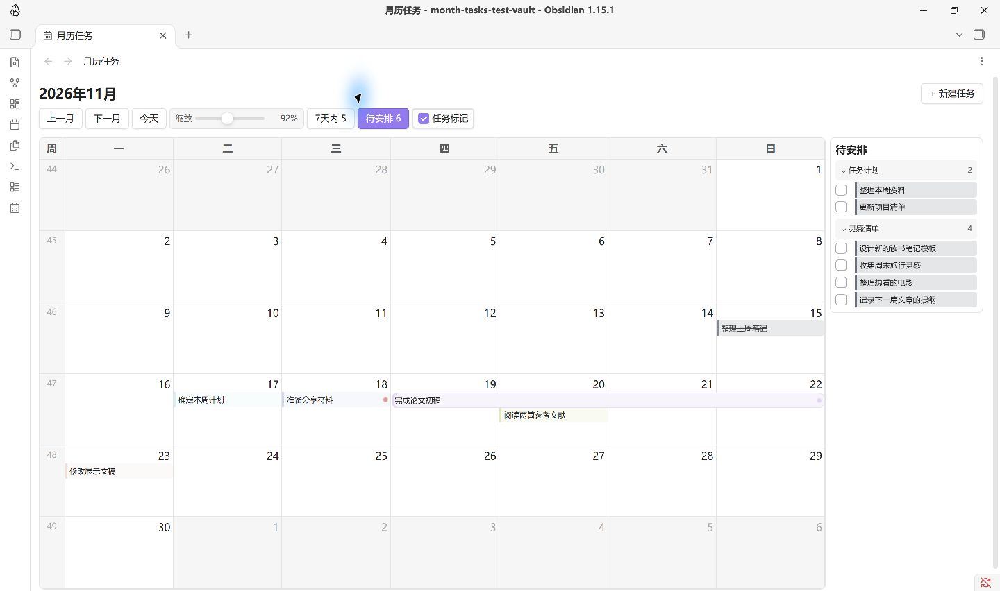
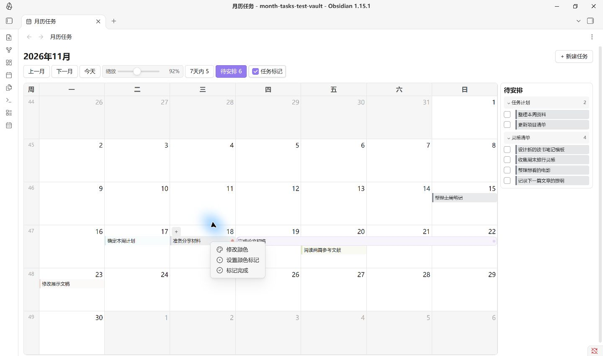
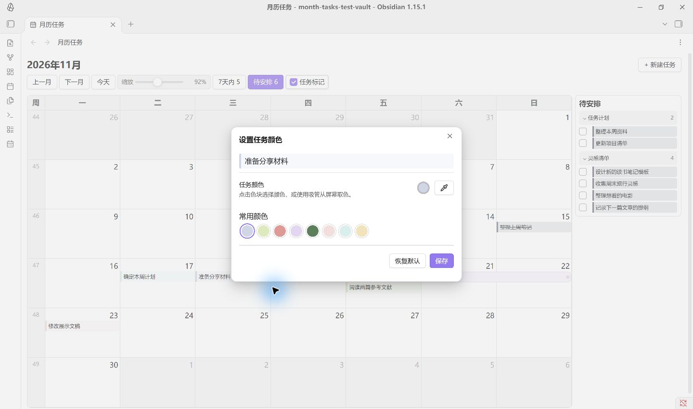

# Month Tasks

> See your Markdown tasks as a month — without moving them out of your notes.
>
> 把散落在笔记里的任务，放进一张真正好用的月历。

[English](#english) · [中文](#中文)



## English

Month Tasks gives ordinary Markdown checkbox tasks a clear monthly home inside Obsidian. Open the calendar and you can immediately see what is due, what spans several days, and what still has no date.

It does not create a separate task database. Your tasks stay in normal Markdown notes, where you can continue editing them by hand or with the tools you already use.

### What does it actually collect?

Think of Month Tasks as a calendar-shaped window into your notes, not as a spreadsheet that imports every note. It scans the folder you choose, picks out recognizable Markdown checkbox lines, and places only those tasks on the calendar:

- a task with a due date appears on that day;
- a task with a start and due date becomes a multi-day bar;
- an unfinished task without a date waits in the pending panel;
- ordinary paragraphs, headings, images, and the rest of each note stay exactly where they are.

The note remains the source of truth. Clicking a task takes you back to its original note, and completing it only changes `[ ]` to `[x]` on that line.

### What it feels like to use

- **Plan with the whole month in view.** Single-day tasks sit inside their date, while tasks with a start and due date become easy-to-read multi-day bars.
- **Keep unscheduled work from disappearing.** The pending-tasks panel collects unfinished tasks without dates and groups them by source note.
- **Use color your own way.** Task colors and optional dot markers are independent, so they can represent projects, energy, interest, urgency, or anything else that makes sense to you.
- **Work directly from the calendar.** Create a task, open its note, change its color, add a marker, or mark it complete without leaving the view.
- **Stay close to plain Markdown.** Month Tasks reads standard checkbox lines and only writes when you create a task or toggle its checkbox.
- **Use it on its own.** Kanban and Tasks are not required. Existing Kanban notes can still be read without depending on board columns.

### A quick look

Right-click a task for the actions you are most likely to need:



Choose from soft preset colors, reuse recent colors, or pick your own:



### Get started in three minutes

1. Install **Month Tasks** from **Settings → Community plugins → Browse** in Obsidian.
2. Open the Month Tasks settings and choose the folder that contains your task notes.
3. Open **Month Tasks** from the command palette or the ribbon, then add dates to tasks with `📅` and `⏳`.

Version 0.1 is currently verified on desktop and is marked as desktop-only.

### Task syntax

Month Tasks recognizes unordered Markdown checkbox tasks:

```markdown
- [ ] Plan next week 📅 2026-11-17
- [ ] Draft the article ⏳ 2026-11-19 📅 2026-11-22
- [x] Organize the notes 📅 2026-11-15
- [ ] An idea without a date
```

- `📅 YYYY-MM-DD` is the due date.
- `⏳ YYYY-MM-DD` is the start date. When both markers exist, the task appears as a multi-day bar.
- An unfinished task with neither marker appears in the pending-tasks panel.
- Dates written as ordinary title text are not parsed.
- Custom states such as `[/]` and `[-]`, block quotes, and ordered-list tasks are not supported.
- Month Tasks does not add a `✅` completion date.

### The pending-tasks panel

The panel collects unfinished tasks that have no start or due date. Tasks are grouped by source note and stay in the same order as they appear in that note. Groups can be collapsed, and the panel remembers its open state.

On a wide view the panel sits beside the calendar. On a narrow view it becomes a drawer, so it never squeezes the calendar below a readable width.

### Colors and markers

Month Tasks offers two independent visual layers:

- **Task color** changes the card or multi-day bar and works well for projects or categories.
- **Dot marker** adds a small user-defined signal and works well for urgency, interest, energy, or any personal meaning.

Neither is generated automatically. Both are stored in the plugin's local `data.json`, not written into your notes.

### Upcoming and overdue summary

The top-bar summary shows unfinished tasks from today through the next N days. You can optionally include overdue tasks and choose how far back the summary should look.

The **Show overdue tasks** setting affects only the top-bar summary and its popup. Past tasks always remain visible on the calendar.

### Creating and completing tasks

Create tasks from the top bar, a date cell's `+` button, or by double-clicking empty space in a date cell. The default target note is configurable.

Month Tasks writes to notes only in two situations:

1. Appending a new task line to the selected note.
2. Toggling `[ ]` and `[x]` after verifying that the original line has not changed.

### Kanban compatibility

Month Tasks is independent from Kanban. Existing Kanban files are treated as read-only task sources: tasks are grouped by note name, not by board column, and the archive after `***` is ignored.

### Data and privacy

- No account, network request, analytics, or data collection.
- Notes stay inside your vault.
- Settings, task colors, marker colors, and panel state are stored locally in `.obsidian/plugins/month-tasks/data.json`.
- To keep colors and settings on another device, sync the plugin directory as well as your Markdown notes.

Backing up your vault before first use is always a good idea.

### Installation alternatives

**BRAT:** add this repository:

```text
https://github.com/hifoilef/obsidian-month-tasks
```

**Manual installation:** download `main.js`, `manifest.json`, and `styles.css` from the latest GitHub release and place them in:

```text
<vault>/.obsidian/plugins/month-tasks/
```

Reload Obsidian and enable **Month Tasks** under Community plugins.

### Known limitations

- Renaming a task can remove its saved task color and marker color.
- Reordering duplicate task titles in the same note can associate a saved color with another duplicate.
- Moving an individual task to another note does not preserve its colors; renaming or moving the entire note does.
- Version 0.1 is currently verified on desktop only.

---

## 中文

Month Tasks 想解决的是一个很朴素的问题：任务明明都写在笔记里，但东一条、西一条，很难一眼看出这个月到底要做什么。

它会读取普通的 Markdown 复选框任务，把有日期的任务放进月历，把跨天任务画成连续时间条，再把还没决定日期的事情收进「待安排」栏。任务始终留在原来的笔记里，不会被搬进另一个数据库。

### 它到底整理了什么？

你可以把它理解成一个“看向笔记的月历窗口”，而不是把所有笔记导入一张大表格。

插件会扫描你指定范围内的 Markdown 文件，但只提取其中能识别的复选框任务：

- 有截止日期的任务，放到对应日期；
- 同时有开始和截止日期的任务，画成跨天条；
- 没有日期的未完成任务，先放进「待安排」；
- 笔记里的正文、标题、图片和其他内容，完全留在原处。

所以笔记仍然是唯一的数据来源。点击月历里的任务会回到原笔记；勾选完成时，插件也只是把那一行的 `[ ]` 改成 `[x]`，不会另存一份任务。


### 它适合什么样的使用方式？

- **想从整个月的角度安排事情。** 单日任务待在日期格里，持续几天的工作会显示成跨天条。
- **习惯先记下来、以后再排日期。** 没有日期的未完成任务会自动进入待安排栏，不会悄悄沉到笔记底部。
- **希望颜色由自己解释。** 卡片颜色和圆点标记彼此独立，你可以拿它们表示项目、兴趣、精力、紧急程度，或者任何对你有用的含义。
- **不想被迫换一套任务系统。** 任务仍然是普通的 `- [ ]` Markdown 行，Kanban 和 Tasks 插件都不是必需品。
- **希望少一点来回切换。** 新建、跳转到原笔记、改色、加标记和勾选完成都可以直接在月历中操作。

右键点一下任务，常用操作都在这里：


### 三分钟开始使用

1. 在 Obsidian 中进入「设置 → 第三方插件 → 浏览」，搜索并安装 **Month Tasks**。
2. 打开 Month Tasks 设置，选择存放任务笔记的扫描文件夹，并指定新任务默认写入的笔记。
3. 从命令面板或左侧功能区打开「月历任务」，给任务加上 `📅` 或 `⏳` 日期即可。

v0.1 当前仅在桌面端完成验证，因此暂时标记为仅桌面端。

### 任务怎么写？

```markdown
- [ ] 确定本周计划 📅 2026-11-17
- [ ] 完成论文初稿 ⏳ 2026-11-19 📅 2026-11-22
- [x] 整理上周笔记 📅 2026-11-15
- [ ] 记录一个还没决定日期的想法
```

- `📅 YYYY-MM-DD` 是截止日期。
- `⏳ YYYY-MM-DD` 是开始日期；同时存在开始和截止日期时，会显示为跨天任务。
- 没有开始日期和截止日期、且尚未完成的任务会进入待安排栏。
- 标题里的普通日期文字不会被识别，例如「课程A6.14」仍然是无日期任务。
- 暂不支持 `[/]`、`[-]` 等自定义状态，也不识别引用块和有序列表中的任务。
- 插件不会写入 `✅` 完成日期。

### 待安排栏

你可以先把事情写下来，不必当场决定日期。待安排栏会收集所有无日期的未完成任务，并按来源笔记分组；组内顺序和任务在笔记中的顺序一致。

每个分组都能折叠，折叠状态和栏的显示状态会被记住。窗口足够宽时，它固定在月历右边；窗口变窄时，它会改成抽屉覆盖在月历上方，不会把日期格挤得看不清。

### 卡片颜色与圆点标记

这不是一套强制分类规则，而是两层可以自由使用的视觉提示：

- **卡片颜色**改变任务卡片或跨天条，适合表示项目、类别或场景。
- **圆点标记**是额外的小提示，可以表示紧急、感兴趣、等待回复，或者任何你自己的含义。

插件不会根据日期自动替你决定标记。两套颜色相互独立，都保存在插件目录的 `data.json` 中，不会写进笔记正文。

内置颜色可以直接选，也可以吸取或输入自己的颜色：


### 未来任务与逾期汇总

顶栏汇总会显示今天到未来 N 天的未完成任务。你可以决定是否在汇总里包含逾期任务，以及向前回溯多少天。

「显示逾期任务」只控制顶栏汇总及其弹窗，不影响月历；过去日期里的任务始终会正常显示。

### 新建与完成任务

可以从顶栏、日期格右上角的 `+`，或双击日期格空白处新建任务。默认目标笔记可以在设置中更改。

插件只会在两种操作中修改笔记：

1. 新建任务时，在目标笔记末尾追加一行。
2. 切换完成状态时，先确认原始任务行没有被外部修改，再切换 `[ ]` 与 `[x]`。

### Kanban 兼容

Month Tasks 完全独立于 Kanban。已有 Kanban 文件只作为只读任务来源：插件按笔记名分组，不使用看板列名，也不会向看板写入任务。`***` 之后的归档区会被忽略。

### 数据与隐私

- 不联网、不需要账户、不收集任何数据。
- 笔记始终留在你的库中。
- 设置、卡片颜色、圆点颜色和面板状态保存在 `.obsidian/plugins/month-tasks/data.json`。
- 如果希望换设备后仍保留颜色和设置，需要同时同步插件目录和 Markdown 笔记。

首次使用前备份笔记库，永远是一个好习惯。

### 其他安装方式

**BRAT：** 添加以下仓库地址：

```text
https://github.com/hifoilef/obsidian-month-tasks
```

**手动安装：** 从最新 GitHub Release 下载 `main.js`、`manifest.json`、`styles.css`，放入：

```text
<你的库>/.obsidian/plugins/month-tasks/
```

重新加载 Obsidian，然后在「第三方插件」中启用 Month Tasks。

### 已知限制

- 修改任务标题后，该任务保存的卡片颜色和圆点标记可能丢失。
- 同一文件中同名任务的顺序改变后，颜色可能对应到另一条同名任务。
- 把单条任务移动到另一篇笔记后，颜色不会跟随；重命名或移动整篇笔记时颜色会跟随。
- v0.1 当前仅在桌面端完成验证。

## Development

```bash
npm install
npm test
npm run build
```

Copy `deploy.config.example.json` to the ignored `deploy.config.json`, set `vaultPath` to a test vault, and run `npm run deploy`.

## License

[MIT](LICENSE) © 2026 Nifern
